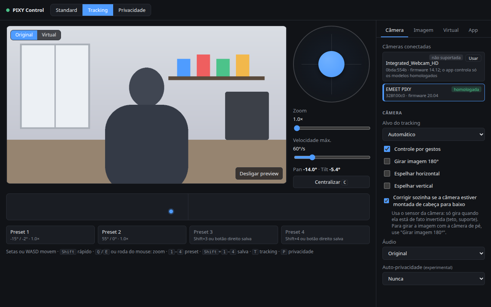
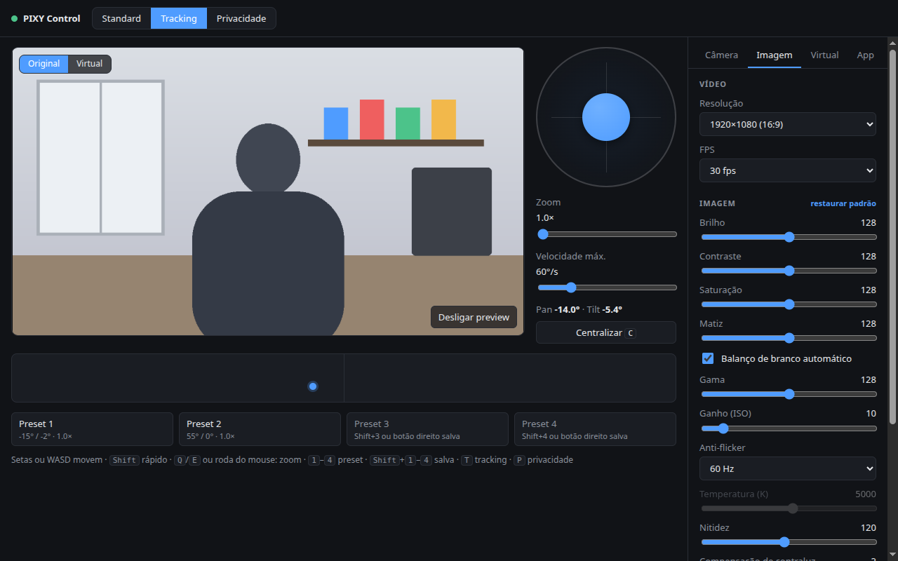
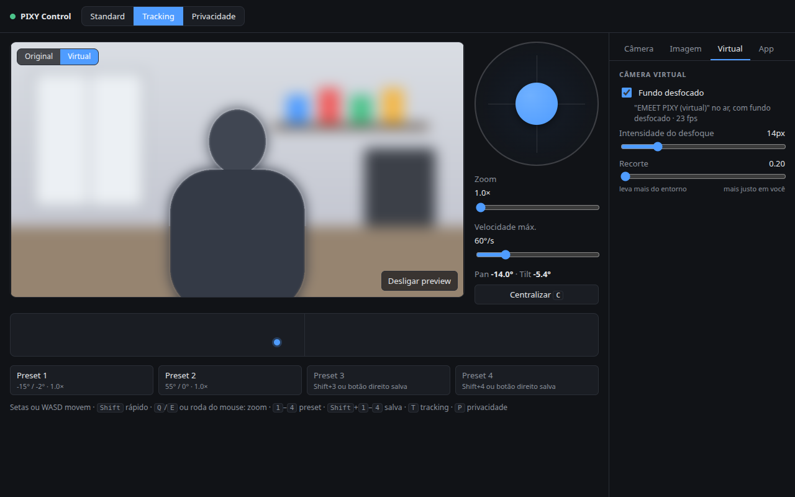
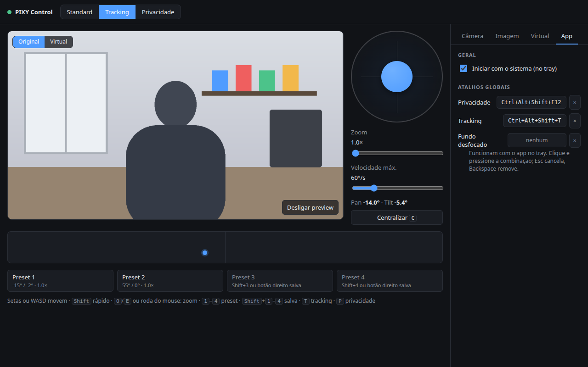

# PIXY Control

[English](README.md) · **Português**

App para Linux que controla a webcam **EMEET PIXY**: privacidade, tracking, gestos e áudio, joystick de PTZ, ícone no tray com atalhos globais e uma câmera virtual com fundo desfocado que fica sempre disponível para Meet, Zoom, OBS e afins.



| Imagem | Câmera virtual | App |
| --- | --- | --- |
|  |  |  |

## Câmeras homologadas

Modelos testados com o app. **Outras webcams funcionam no básico**: escolha a câmera na aba **Câmera → Câmeras conectadas** (botão "Usar") e o app usa os controles padrão (UVC/V4L2): imagem, zoom e pan/tilt quando a câmera tiver, preview, resolução e FPS, e a câmera virtual com fundo desfocado. O que depende dos controles do fabricante (modo, privacidade, tracking, gestos, áudio) fica desativado na interface, com o motivo. Preferências, resolução e FPS são guardados por câmera.

| Câmera | USB | Firmware | Testado em | O que funciona |
| --- | --- | --- | --- | --- |
| EMEET PIXY | `328f:00c0` | 20.04 | 14/10/2026 | PTZ com joystick, tracking e alvo, privacidade, gestos, espelhamento e auto-rotação, modo de áudio, imagem (V4L2), modos até 4K30 e 1080p60, câmera virtual com fundo desfocado |

Testou outro modelo ou outro firmware? Abra uma issue pelo modelo [**Relatar câmera**](https://github.com/aronpc/pixy-control/issues/new?template=camera-report.yml), com o modelo, USB e firmware que o app mostra na aba **Câmera**, e o que funcionou. A lista fica em [`src/cameras.json`](src/cameras.json).

## Instalar

Baixe a [última versão](https://github.com/aronpc/pixy-control/releases/latest):

- **AppImage** (recomendado): se atualiza sozinho. Depois de baixar, rode uma vez o setup do sistema (abaixo).
  ```sh
  chmod +x pixy-control-*.AppImage && ./pixy-control-*.AppImage
  ```
- **.deb** (Debian/Ubuntu): instala a regra de acesso à câmera junto. Não se atualiza sozinho; o app avisa quando há versão nova.
  ```sh
  sudo apt install ./pixy-control-*.deb
  ```

### Configuração do sistema (uma vez)

O app precisa de três coisas do sistema. A faixa de diagnóstico no topo da janela diz o que falta e o comando para resolver; o script abaixo faz tudo de uma vez.

1. **Acesso ao HID da câmera** (privacidade, tracking, gestos, PTZ): uma regra udev, já que por padrão só o root acessa.
2. **v4l2loopback** com um device "EMEET PIXY (virtual)": é a câmera virtual.
3. **Regra do WirePlumber**: no Ubuntu 24.04 (PipeWire 1.0 + xdg-desktop-portal 1.18) o portal não libera câmeras para apps fora de Flatpak, e o preview diria que não há câmera.

```sh
sudo apt install v4l2loopback-dkms      # se ainda não tiver
sudo ~/.config/pixy-control/system/setup/pixy-control-setup   # o app copia o script para cá ao abrir
systemctl --user restart wireplumber
```

Já tem outra configuração do v4l2loopback? Acrescente nela um device com `card_label="EMEET PIXY (virtual)"` e `exclusive_caps=1`, por exemplo:

```
options v4l2loopback devices=2 video_nr=10,11 card_label="Outra,EMEET PIXY (virtual)" exclusive_caps=1,1
```

`exclusive_caps=1` é obrigatório: com `0` o device anuncia saída junto com captura, e Chrome, Edge (Teams, Meet), Zoom e outros o descartam.

Dependências: `python3`, `ffmpeg`, `pipewire-bin` (`pw-dump`, `pw-cli`), `gstreamer1.0-tools` e `gstreamer1.0-pipewire` e, para os atalhos globais, o GNOME.

## O que o app faz

- **Modo da câmera**: Standard, Tracking e Privacidade, pelos botões, pelo tray ou por atalho global. Privacidade alterna: desligar volta ao modo de antes.
- **PTZ**: joystick com velocidade proporcional, teclado, mapa clicável e 4 presets.
- **Imagem girada 180°** (câmera presa de cabeça para baixo), espelhamento e correção automática pelo sensor da câmera.
- **Várias câmeras**: escolha qual usar; as não homologadas ficam no básico, com o que não suportam desativado.
- **Câmera virtual** "EMEET PIXY (virtual)": sempre no ar com o app aberto (inclusive no tray). "Fundo desfocado" só liga e desliga o efeito, ao vivo, então quem está usando a câmera virtual não a perde.
- **Imagem no modo privacidade**: com a câmera em privacidade, a câmera virtual mostra uma imagem sua (ou o cartão "Câmera em pausa") em vez do preto da lente recolhida. Ao sair da privacidade, a imagem pode ficar mais alguns segundos (padrão 2 s, configurável) enquanto a lente sobe e a exposição se ajusta. Vale só para a câmera virtual; apps usando a câmera direto continuam vendo preto.
- **Vídeo**: escolha de resolução e FPS entre os modos que a câmera oferece (até 4K30 e 1080p60). Com blur, a saída é limitada a 1920×1080.
- **Preview** da câmera ou da câmera virtual, sem travar a câmera para outros apps (usa o PipeWire).
- **Imagem**: brilho, contraste, foco, exposição, balanço de branco, anti-flicker e os demais controles que a câmera anuncia.
- **Atalhos globais** configuráveis na própria janela, com aviso de conflito com atalhos do GNOME.
- **Tudo fica salvo** e volta sozinho: ajustes da câmera são reaplicados quando o app abre e sempre que a câmera reaparece (ela esquece ou restaura valores antigos ao reiniciar).
- **Iniciar com o sistema**, direto no tray.
- **Diagnóstico** no início: se faltar algo no sistema, uma faixa diz o quê, o que é afetado e o comando para resolver.
- **Atualização automática** no AppImage, pelas releases do GitHub.

As configurações ficam em abas: **Câmera** (câmeras conectadas e controles do fabricante), **Imagem** (resolução, FPS e ajustes), **Virtual** (câmera virtual, blur e imagem da privacidade) e **App** (início com o sistema e atalhos).

### Controles

| Ação | Mouse | Teclado |
| --- | --- | --- |
| Pan/tilt contínuo | arrastar o joystick | setas ou WASD; `Shift` = rápido |
| Zoom | roda do mouse sobre o joystick, slider | `Q`/`E` ou `-`/`+` |
| Apontar direto | clicar no mapa | — |
| Centralizar | botão | `C` ou `Home` |
| Presets 1–4 | clique = ir, botão direito = salvar | `1`–`4` ir, `Shift`+`1`–`4` salvar |
| Tracking / Privacidade | botões no topo | `T` / `P` |
| Parar o movimento | — | `Espaço` |
| De qualquer lugar | menu do tray | atalhos globais (padrão `Ctrl+Alt+Shift+P` / `T`) |

Fechar a janela só esconde no tray; sair é pelo menu do tray.

## Problemas conhecidos

- **Preview ou câmera virtual sem imagem**: outro programa abriu a câmera direto (sem PipeWire). O app diz qual e volta sozinho quando ela é solta.
- **Zoom da PIXY em 1920×1080 a 60 fps**: a câmera ignora o zoom nesse modo (limitação do firmware). O app desativa o zoom ali e indica 30 fps ou 1280×720 a 60.
- **FPS menor que o máximo do modo** (ex.: 1080p a 30): o Chromium abriria a câmera na taxa máxima e descartaria quadros, então o app fixa o modo exato antes, com um consumidor mínimo do GStreamer (`gstreamer1.0-tools` e `gstreamer1.0-pipewire`). Sem o GStreamer, a câmera fica na taxa máxima.
- **FPS abaixo do escolhido**: com pouca luz a própria câmera estende a exposição e baixa a taxa. Em 4K o blur fica perto de 20 fps.
- **Modo "ocioso"**: sem nenhum app usando o vídeo, a PIXY ignora pedidos de tracking e acorda sempre em standard. O app guarda o modo escolhido e o reaplica quando o vídeo abre.
- **Imagem preta na câmera virtual**: a câmera está em modo privacidade.
- **Câmera virtual fora de apps que usam a câmera pelo PipeWire** (Chrome/Edge com a flag de câmera PipeWire, fonte PipeWire do OBS): o PipeWire cadastra o v4l2loopback quando o módulo carrega, antes de o app escrever nele, e com `exclusive_caps=1` ele só passa a anunciar captura depois. Use esses apps pelo modo V4L2 normal (o padrão do Teams, Meet, Zoom e OBS), que enxerga a câmera virtual.
- O tilt vai de −52° a 90°; abaixo disso a câmera só aponta para a própria base.
- Mexer no joystick com o tracking ligado muda para Standard, senão o tracking brigaria com a mão.

Os erros do app ficam em `~/.config/pixy-control/pixy-control.log`.

## Como funciona

- **`helper/pixyd.py`** (Python, só biblioteca padrão) é um processo vivo que fala JSON por linha com o Electron. Usa V4L2 por `ioctl` direto e o HID do fabricante (`/dev/hidrawN`, relatório `0x09` de 32 bytes). Recusa os grupos HID de energia, firmware e SD e os comandos de factory reset e identidade.
- **PTZ**: controles UVC padrão; o joystick dá ao motor o limite do eixo como alvo e ajusta a velocidade pelo HID. Sem comando por 0,4 s, o helper para a câmera sozinho.
- **Preview e câmera virtual** abrem a câmera pelo PipeWire (portal), pedindo o modo nativo exato (`resizeMode: "none"`), e dividem a câmera com outros clientes PipeWire. Quem abre a câmera primeiro define o formato para todos.
- **Câmera virtual**: uma janela oculta lê os quadros com `MediaStreamTrackProcessor`, recorta a pessoa com o selfie segmenter do MediaPipe (a cada dois quadros) e desfoca o fundo; o quadro vira I420 num shader WebGL, é lido de forma assíncrona e vai para um `ffmpeg` que escreve no v4l2loopback. Enquanto escreve, o app mantém `$XDG_RUNTIME_DIR/pixy-control-virtual.json` (device e PID), para outros programas saberem que há imagem.
- **Atalhos globais** são atalhos personalizados do GNOME que chamam `pixy-toggle`, que fala com o app por `$XDG_RUNTIME_DIR/pixy-control.sock`. O `globalShortcut` do Electron não serve no X11 quando o layout de teclado ativo não é o primeiro da lista.
- **Segurança**: `contextIsolation`, `sandbox`, CSP, IPC aceito só das páginas do app, navegação e janelas novas bloqueadas, câmera liberada só para as páginas do app, fuses (`RunAsNode` e afins desligados, app só do asar).

## Desenvolvimento

```sh
npm install
npm start            # ou: npm start -- --hidden (direto no tray)
npm run lint
npm test             # testes em JS (node:test) e do helper (unittest), sem precisar da câmera
npm run dist         # AppImage e .deb em release/
```

### Publicar uma versão

Atualize a versão no `package.json`, faça o commit e crie a tag igual:

```sh
npm version patch    # ou minor/major: muda o package.json, commita e cria a tag vX.Y.Z
git push --follow-tags
```

O GitHub Actions roda lint e testes, gera o AppImage e o `.deb` e publica a release. Os AppImages instalados encontram a versão nova sozinhos.

## Créditos

O protocolo HID vem de engenharia reversa da comunidade e foi conferido nesta câmera (firmware 20.04):
[PixyDeck](https://github.com/dalu951/pixydeck), [emeet-pixyd](https://github.com/LarsArtmann/emeet-pixyd),
[Pixy Arch](https://github.com/Dkrynen/pixy-arch) e o [gist do branzo](https://gist.github.com/branzo/de238cfe001fa4a834ca21ac43dca580).
Recorte de pessoa: [MediaPipe](https://github.com/google-ai-edge/mediapipe) (selfie segmenter, Apache-2.0).

## Licença

[MIT](LICENSE)
